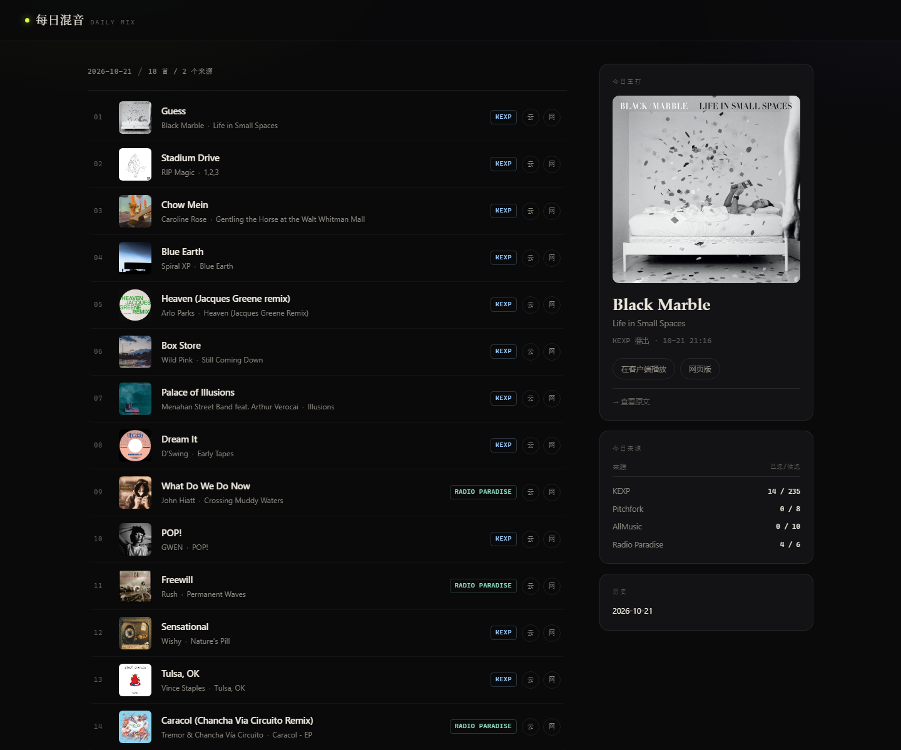

# 每日混音 · Daily Mix

每天从几家高质量音乐站点抓取「人已经替你选过」的内容，合成一张 18 首的本地歌单：
一键跳到网易云音乐播放、导出 CSV 迁移到自己的账号。也可以发布成静态站点，手机随时打开。



## 快速开始

双击 **`启动.bat`**，等浏览器自动打开 `http://127.0.0.1:8787/`。
**每次启动都会重新生成一张当天歌单**，需要 30–90 秒；同一天在页面里刷新不会重复生成。
关闭那个命令行窗口即停止服务。

- 运行环境：Windows + Python 3.10 以上，**零第三方依赖**（只用标准库）。
- 数据都在本机：`data/dailymix.db`（SQLite）。删掉这个文件就重置全部历史。

## 发布成静态网站（手机随时看）

不想一直开着电脑，就把生成放到云端：GitHub Actions 每天跑一次，Cloudflare Pages 托管，
手机打开固定地址即可，电脑关机也不影响。

```bash
python export_site.py          # 本地试渲染，产物在 site/
```

完整步骤见 [DEPLOY.md](DEPLOY.md)。

## 数据源

| 来源 | 抓什么 | 说明 |
|---|---|---|
| [KEXP](https://www.kexp.org/) | 过去 24 小时的播出曲目 | 西雅图公共电台，人工编排；带「重度轮播」等权重 |
| [Pitchfork](https://pitchfork.com/reviews/best/albums/) | 最佳新专辑 | 取榜单条目，再用单篇页的 `og:title` 解析「艺人: 专辑」 |
| [AllMusic](https://www.allmusic.com/newreleases) | 本周编辑精选新碟 | 页面内嵌 JSON-LD，结构最干净 |
| [Radio Paradise](https://radioparadise.com/) | 6 个频道的正在播放 | 人工编排、无广告，跨年代选曲 |

专辑类来源会通过 iTunes Search 解析出一首代表曲目，同时拿到封面。
所有来源都是**公开页面/公开接口**，没有登录、没有绕过付费墙。任一来源挂掉只会在侧栏报错，不影响出歌单。

## 每日歌单怎么来

- 目标 18 首；同一艺人只出现一次，同一曲风最多 4 首。
- 来源配额：KEXP ≤9、Pitchfork ≤4、AllMusic ≤4、Radio Paradise ≤4。
- 去重：电台曲目 14 天内不重复；专辑类来源因为「每周才更新」，窗口放宽到 7 天。
- 排序：编辑推荐优先当「今日主打」，其余按日期做确定性打乱（同一天刷新不会跳来跳去）。
- 分数 = 来源权重 + KEXP 轮播等级 + 发行时间新鲜度。

## 导入网易云音乐

1. **导出 CSV** → 交给 [Soundiiz](https://soundiiz.com/) 或 [TuneMyMusic](https://www.tunemymusic.com/) 导入到网易云账号（最稳）。
2. **复制清单** → 纯文本「艺人 — 曲目」，贴到任意支持文本导入的工具。
3. **单曲跳转** → 每行的「云」按钮直接用浏览器打开对应歌曲页，手动收藏。

> 说明：网页本身无法直接往网易云写歌单（跨域 + 登录态 + 无公开 API）。
> 这个项目是「本地服务 + 网页界面」，后端理论上可以带你的 Cookie 调接口直建歌单，但那属于非官方接口，
> 有风控和失效风险，所以默认没做。需要的话可以再加。

## 清理缓存

页面右下角「本地数据」卡片会显示数据库大小和各类条数，点 **清理过往缓存** 会删除：

- 今天之前的历史歌单
- 封面 / 网易云的匹配缓存
- 30 天前的去重记录

**今天的歌单会保留**，操作前有二次确认。清理后文件会立即收缩（VACUUM），但下次生成需要重新联网补齐缓存，会慢一些。

## 跳到网易云客户端

- 本机访问时，点「云」按钮会调用 `/api/open-client`，由本地服务通过 `os.startfile` 唤起客户端并直接播放该曲目。
- 手机或外网访问时，按钮退化为网易云网页版链接（`music.163.com/song?id=...`）。
- 公网请求（带 `Cf-Ray` 头）调用该接口会被拒绝，避免远程控制这台电脑。

深链格式不是猜的，是 `orpheus://` + base64(JSON)：

```python
{"type": "song", "id": "3380829391", "cmd": "play"}
```

写成 `orpheus://song/<id>` 这种形式客户端**不会响应**——这是之前踩过的坑。

如果点了没反应，检查这个注册表项：

```
HKCU\Software\Classes\orpheus\shell\open\command
```

网易云安装器经常把它写成 `"...cloudmusic.exe"--webcmd="%1"`（少了空格），Windows 无法解析，协议就失效。
本机于 2026-10-21 修正过，原值备份在 `backup/orpheus-HKCR-*.reg`，还原命令：

```
reg delete "HKCU\Software\Classes\orpheus" /f
```

## 文件结构

```
dailymix/
├─ 启动.bat            双击启动
├─ 停止.bat            停止后台实例
├─ 开启隧道.bat         临时公网地址 + 二维码
├─ 开机自启.vbs         静默启动脚本（需自行放到 shell:startup）
├─ app.py              入口：起服务、开浏览器
├─ server.py           路由 / 静态资源 / 后台生成任务
├─ sources.py          四个来源的抓取与解析
├─ enrich.py           iTunes 封面、网易云深链、缓存
├─ builder.py          选曲：去重、配额、排序
├─ store.py            SQLite：歌单、历史、缓存
├─ export_site.py      生成静态站点（site/）
├─ DEPLOY.md           云端部署步骤
├─ .github/workflows/  每天定时生成的 Actions 配置
├─ web/                前端（原生 HTML/CSS/JS，无框架）
├─ site/               静态站点产物
└─ data/dailymix.db    本地数据
```

## 常见问题

**端口被占用？** 会自动尝试 8787–8811，控制台里会打印实际地址。

**某些歌没有封面？** iTunes 没匹配到，属于正常情况；点行尾的「云」去网易云听完整版。

**来源报错？** 侧栏「今日来源」下方会列出失败原因。AllMusic 对请求头敏感，偶尔会 403，重试即可。

**想加/换来源？** 在 `sources.py` 里加一个 `fetch_xxx()`，返回 `Candidate` 列表，再注册进 `fetch_all()` 即可。

## 免责

仅供个人使用。抓取的是各站公开页面，请遵守目标站点的服务条款与 robots 约定，不要高频请求。
封面版权归各自权利人所有。
